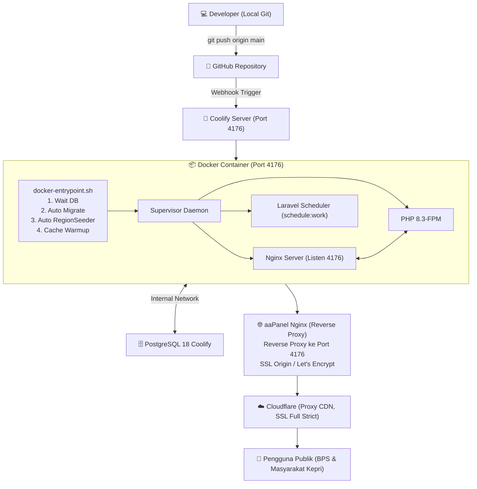

# 🌦️ BUKU PANDUAN DEPLOYMENT A-Z & TROUBLESHOOTING PROYEK CERAH KEPRI
### Arsitektur Laravel 12 (PHP 8.3-FPM + Nginx + PostgreSQL + Coolify Port 4176 + Reverse Proxy aaPanel & Cloudflare)

---

## 1. Identitas Framework: Mengapa Deploy Laravel Berbeda dengan Next.js?

Pada proyek sebelumnya (**KEMUDI**), aplikasi berbasis **Next.js 15 (Node.js Runtime)** yang menghasilkan berkas standalone JavaScript dan dijalankan langsung oleh binary `node server.js`.

Sedangkan **CERAH KEPRI** adalah proyek berbasis **Laravel 12 (PHP 8.3)**. Karakteristik deployment-nya memiliki perbedaan mendasar:

| Kategori | Next.js Fullstack (Proyek KEMUDI) | Laravel 12 Fullstack (Proyek CERAH KEPRI) |
| :--- | :--- | :--- |
| **Bahasa & Runtime** | JavaScript / TypeScript (Node.js 22) | PHP 8.3 + Node.js (hanya saat build frontend) |
| **Server Engine** | Standalone Node.js HTTP Server (`node server.js`) | **Nginx Web Server** + **PHP-FPM** |
| **Kompilasi Frontend** | `npm run build` menghasilkan `.next/standalone` | `npm run build` (Vite) menghasilkan berkas statis di `public/build/` |
| **Database & ORM** | Prisma ORM (`prisma db push`) | Eloquent ORM (`php artisan migrate --force`) |
| **Proses Background** | Biasanya thread internal Node.js | **Laravel Scheduler Worker** (`php artisan schedule:work`) via Supervisor |
| **Hak Akses Berkas** | Standar user node | Folder `storage/` dan `bootstrap/cache/` **wajib writeable** oleh user `www-data` |
| **Kunci Enkripsi** | JWT secret atau random string | **`APP_KEY`** (32 byte base64) wajib ada untuk enkripsi sesi dan cookies |

> [!IMPORTANT]
> Di dalam container Docker Coolify, kita membungkus **Nginx**, **PHP-FPM**, dan **Laravel Scheduler** menjadi satu kesatuan menggunakan **Supervisor**. Nginx di dalam container akan langsung mendengarkan trafik pada **Port 4176**.

---

## 2. Topologi & Alur Deployment End-to-End

Berikut adalah alur komunikasi sistem dari laptop hingga diakses publik melalui Cloudflare dan aaPanel:



---

## 3. Bedah Berkas Kunci Deployment

Semua berkas konfigurasi deployment telah dibuat dan disesuaikan di dalam folder proyek:

### A. Dockerfile Multi-Stage (`Dockerfile`)
Ukuran image dirampingkan dengan 3 tahap isolasi:
1. **Tahap 1 (`frontend`)**: Menggunakan `node:22-alpine` untuk mengompilasi aset Tailwind CSS v4 dan Vite (`npm run build`).
2. **Tahap 2 (`vendor`)**: Menggunakan `composer:2` untuk mengunduh pustaka PHP production (`composer install --no-dev --optimize-autoloader`).
3. **Tahap 3 (`runner`)**: Menggunakan `php:8.3-fpm-alpine`, menginstal ekstensi PostgreSQL (`pdo_pgsql`, `pgsql`), Nginx, dan Supervisor. Mendengarkan di **Port 4176**.

### B. Entrypoint Otomatis Database (`docker-entrypoint.sh`)
Script ini dieksekusi otomatis setiap kali container menyala di Coolify:
- **Auto `.env` & `APP_KEY`**: Jika belum disetel di environment, sistem otomatis membuat dan mengisi kunci enkripsi.
- **Auto Port Config**: Menyetel Nginx ke port `4176`.
- **Database Wait Loop**: Menunggu server PostgreSQL siap menerima koneksi (hingga 30 detik).
- **Auto Migration (`php artisan migrate --force`)**: Menyelaraskan tabel database tanpa perlu SSH manual.
- **Auto Seeding Wilayah (`php artisan db:seed --class=RegionSeeder --force`)**: Mengisi data 505 desa/kelurahan Kepri agar fitur cuaca dan peta langsung aktif.
- **Cache Optimization**: Menjalankan `config:cache`, `route:cache`, dan `view:cache` demi performa maksimal.
- **Start Supervisor**: Menjalankan Nginx, PHP-FPM, dan Scheduler.

### C. Supervisor (`docker/supervisord.conf`)
Menjalankan 3 proses krusial sekaligus di dalam container:
1. `php-fpm` (melayani eksekusi PHP)
2. `nginx` (web server melayani port 4176)
3. `laravel-scheduler` (`php artisan schedule:work` yang otomatis mengambil cuaca berkala, sinkronisasi berita BMKG/RSS setiap 30 menit, dan pembersihan log lama).

### D. Reverse Proxy Trust (`bootstrap/app.php`)
Telah ditambahkan konfigurasi:
```php
$middleware->trustProxies(at: '*');
```
Konfigurasi ini memastikan Laravel membaca header `X-Forwarded-Proto: https` dari aaPanel dan Cloudflare, sehingga tautan aset dan redirect tidak terkena masalah **Mixed Content (HTTP vs HTTPS)**.

---

## 4. Konfigurasi Nginx Reverse Proxy di aaPanel (Sangat Krusial)

Di panel aaPanel Anda:
1. Buka **Website** ➔ Tambahkan Domain (misal `cerah.gurind.am` atau domain yang Anda tentukan).
2. Masuk ke menu **Reverse Proxy** ➔ **Add Reverse Proxy**.
3. Isi Target URL dengan IP Coolify dan port **4176**:
   - Contoh: `http://100.111.255.46:4176` (atau IP server Coolify Anda).
4. Klik **Edit Config** pada Reverse Proxy tersebut, lalu ganti/sesuaikan konfigurasinya dengan aturan berikut:

```nginx
# ====================================================================
# Konfigurasi Ukuran Maksimal & Timeout (Letakkan di dalam block server)
# ====================================================================
client_max_body_size 100M;

#PROXY-START/
location ^~ /
{
    # Arahkan ke IP Server Coolify pada Port 4176
    proxy_pass http://100.111.255.46:4176;
    proxy_http_version 1.1;

    # Header Identitas Client, Host, dan Cloudflare Real-IP
    proxy_set_header Host $host;
    proxy_set_header X-Real-IP $remote_addr;
    proxy_set_header X-Forwarded-For $proxy_add_x_forwarded_for;
    proxy_set_header X-Forwarded-Proto $scheme;
    proxy_set_header X-Forwarded-Host $host;
    proxy_set_header X-Forwarded-Server $host;

    # Meneruskan IP Asli dari Cloudflare jika menggunakan Cloudflare
    proxy_set_header CF-Connecting-IP $http_cf_connecting_ip;

    # Dukungan WebSocket & SSE
    proxy_set_header Upgrade $http_upgrade;
    proxy_set_header Connection "upgrade";

    # Timeout & Buffer
    proxy_pass_request_headers on;
    proxy_max_temp_file_size 0;
    proxy_connect_timeout 600;
    proxy_send_timeout 600;
    proxy_read_timeout 600;
    proxy_buffer_size 128k;
    proxy_buffers 4 256k;
    proxy_busy_buffers_size 256k;
    proxy_temp_file_write_size 256k;

    # ====================================================================
    # ANTI-CACHE: Mencegah Nginx menyimpan cache halaman dinamis / data cuaca
    # ====================================================================
    proxy_buffering off;
    proxy_cache off;
    proxy_no_cache 1;
    proxy_cache_bypass 1;
    add_header Cache-Control "no-store, no-cache, must-revalidate, proxy-revalidate, max-age=0";
    add_header Pragma "no-cache";
    add_header Expires "0";
}
#PROXY-END/
```

---

## 5. Konfigurasi Environment Variables di Coolify

Saat menambahkan project di Coolify (**Application ➔ Dockerfile**), masukkan variabel-variabel berikut di tab **Environment Variables**:

| Variable Name | Nilai Rekomendasi | Keterangan |
| :--- | :--- | :--- |
| `APP_NAME` | `Cerah Kepri` | Nama aplikasi |
| `APP_ENV` | `production` | Mode environment produksi |
| `APP_KEY` | *(Biarkan kosong atau isi base64 kunci)* | Jika kosong, entrypoint akan membuatnya otomatis |
| `APP_DEBUG` | `false` | Wajib false di production |
| `APP_URL` | `https://domain-anda.com` | Domain publik lengkap dengan https |
| `PORT` | `4176` | Port listening container |
| `DB_CONNECTION` | `pgsql` | Driver database PostgreSQL |
| `DB_HOST` | *(Nama host container PostgreSQL di Coolify)* | Misal: `ag0scokww04gs08ck84gw48k` atau nama service |
| `DB_PORT` | `5432` | Port internal PostgreSQL Coolify |
| `DB_DATABASE` | `cerah_weather` | Nama database |
| `DB_USERNAME` | `postgres` (atau user yang dibuat di Coolify) | User database |
| `DB_PASSWORD` | *(Password database Anda)* | Password database |
| `SESSION_DRIVER` | `file` | Driver session |
| `CACHE_STORE` | `file` | Driver cache |
| `QUEUE_CONNECTION` | `sync` | Driver queue |

> [!TIP]
> **Host Database di Coolify**: Jangan menggunakan `127.0.0.1` atau `localhost` untuk `DB_HOST` di Coolify. Gunakan nama hostname internal container PostgreSQL Coolify yang berada dalam satu network Docker.

---

## 6. Troubleshooting Playbook: Solusi Kendala Nyata

### Kendala 1: Halaman HTTPS Terbuka tetapi Rusak (CSS/JS tidak termuat atau Mixed Content)
- **Penyebab**: Laravel mengira request datang melalui HTTP biasa (dari reverse proxy aaPanel), sehingga menghasilkan link aset `http://...`.
- **Solusi**: 
  1. Pastikan `bootstrap/app.php` memiliki `$middleware->trustProxies(at: '*');` *(sudah terpasang)*.
  2. Pastikan `APP_URL` di Coolify diawali dengan `https://`.
  3. Pastikan aaPanel menyertakan header `proxy_set_header X-Forwarded-Proto $scheme;`.

### Kendala 2: Error 500 "No application encryption key has been specified"
- **Penyebab**: `APP_KEY` belum terpasang.
- **Solusi**: Di `docker-entrypoint.sh`, pengecekan `APP_KEY` telah diotomatisasi. Jika ingin membuat manual, buka terminal container di Coolify lalu jalankan:
  ```sh
  php artisan key:generate --show
  ```
  Salin string tersebut dan masukkan ke tab Environment Variable Coolify sebagai `APP_KEY`.

### Kendala 3: Peta atau Pilihan Wilayah Kepri Kosong
- **Penyebab**: Database baru belum diisi data wilayah (`regions`).
- **Solusi**: `docker-entrypoint.sh` otomatis mengeksekusi `php artisan db:seed --class=RegionSeeder --force`. Jika ingin memicu ulang secara manual:
  ```sh
  php artisan db:seed --class=RegionSeeder --force
  ```

### Kendala 4: Berita atau Data Iklim Historis Tidak Bergerak / Update
- **Penyebab**: Scheduler tidak berjalan.
- **Solusi**: Container ini sudah dilengkapi program `laravel-scheduler` di dalam `supervisord.conf`. Anda dapat mengecek log scheduler di dalam container:
  ```sh
  cat /var/www/html/storage/logs/scheduler.log
  ```
  Atau jalankan sync manual lewat web atau terminal container:
  ```sh
  php artisan news:sync
  php artisan weather:aggregate-daily
  ```

### Kendala 5: Cloudflare Error 502 / 504 Bad Gateway
- **Penyebab**: aaPanel tidak dapat menghubungi port 4176 pada IP Coolify, atau firewall belum dibuka.
- **Solusi**:
  1. Pastikan port 4176 diizinkan di firewall server Coolify (misal: `ufw allow 4176/tcp` atau melalui interface Tailscale).
  2. Periksa status container di Coolify, pastikan statusnya **HEALTHY / RUNNING**.

---

## 7. Cheatsheet Alur Rilis Cepat

Gunakan alur 3 langkah ini saat deploy:

```powershell
# 1. Commit dan push perubahan konfigurasi Docker ke repository
git add .
git commit -m "feat: setup Dockerfile port 4176 for Coolify and aaPanel reverse proxy"
git push origin main
```

```text
2. Pantau Deployment di Dashboard Coolify:
- Buka Coolify -> Project Cerah Kepri -> Deployments.
- Tunggu log menampilkan:
  "🌦️ CERAH KEPRI Starting up..."
  "✅ Database PostgreSQL berhasil terhubung!"
  "🚀 Menjalankan Server Nginx & PHP-FPM di port 4176..."
- Status container berubah menjadi HEALTHY.
```

```text
3. Verifikasi di Browser:
- Buka domain publik (misal: https://cerah.gurind.am).
- Cek dropdown navigasi wilayah (505 kelurahan/desa se-Kepri).
- Cek pembaruan cuaca dan peta leaflet interaktif.
```
